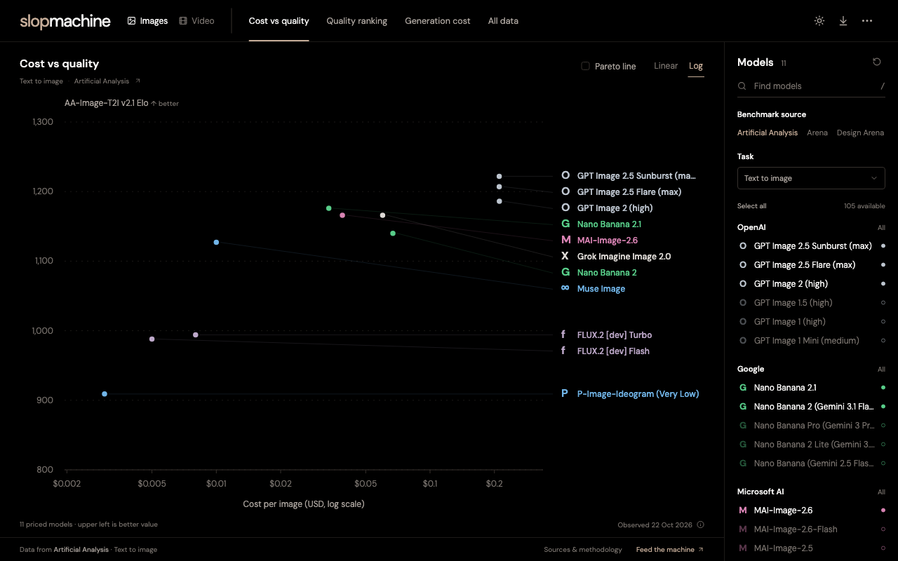

# Slop Machine

**The price of pixels.** Image and video model analytics in the compact, chart-first style of [Slopalytics](https://slopalytics.com/).

Compare generation quality, API cost, and the price/quality frontier using attributed observations from [Artificial Analysis](https://artificialanalysis.ai/), [Arena](https://arena.ai/), [Design Arena](https://www.designarena.ai/leaderboard?tab=image), and specialized video arenas. Each source, task, benchmark version, and audio condition has its own leaderboard.



## Run locally

Requires Node.js 22.12 or newer.

```sh
npm ci
npm run dev -- --host 0.0.0.0
```

Open the URL printed by Vite. The application runs entirely in the browser and needs no API key or backend.

```sh
npm run data:validate
npm run build
npm run preview
```

`dist/` is a static build with relative asset paths, suitable for hosting under a subdirectory.

## What it does

- Switch between image generation, image editing, and video benchmark pools.
- Explore cost versus quality with linear or log pricing axes and a Pareto frontier.
- Inspect quality rankings, confidence intervals, generation-cost estimates, and sortable data.
- Search and toggle individual models or complete provider groups.
- Download charts as PNG, selected observations as CSV, or the full catalog as JSON.
- Use dark or light mode, mobile filters, and shareable task/view URLs.

The initial selection includes leading models and the observed price/quality frontier. Select all models in the sidebar to explore the complete source pool. Press `/` to search models.

## Data

The bundled catalog is a snapshot, not a live feed. It records source URLs, collection times, leaderboard publication dates when available, price conditions, sample counts, and confidence bounds. Missing values stay missing. Video costs are expressed per second; image costs are expressed per image.

The initial release includes 749 observations in 18 pools across five sources, with 438 reported prices or source quotes. Design Arena quotes have unspecified resolution/quality settings. World Model Arena covers first-person world models; MemeBench covers silent Chinese meme clips. These specialized pools carry visible qualifications and stay separate from general generation benchmarks.

Artificial Analysis states restrictions on scraping and public comparison-product reuse in its [website terms](https://artificialanalysis.ai/terms-of-use). Source visibility and attribution do not grant a separate reuse license. The application code license does not extend to third-party benchmark data. See the linked source-use facts in the data documentation.

Rebuilding the catalog validates and combines the research snapshots:

```sh
npm run data:build
npm run data:validate
```

Collection and refresh procedures, source coverage, and attribution are documented in [docs/DATA.md](docs/DATA.md). Rebuilding a catalog does not refresh source observations.

Elo values are comparable only within their source benchmark pool. A narrow rank difference or overlapping confidence interval does not establish a meaningful quality difference. Cost estimates use the source's published generation conditions, so check each model's pricing details before budgeting.

## Project layout

```text
src/                 React interface and SVG charts
public/data/         Validated catalog consumed by the browser
research/            Normalized observations and research notes
scripts/             Catalog normalization, validation, and refresh tooling
docs/                Source methodology and screenshots
```

## Credits and license

Created by [Zer0codestuff](https://github.com/Zer0codestuff). Visual direction inspired by Slopalytics; this is an independent implementation with no affiliation to the source sites.

Application code is [MIT licensed](LICENSE). Third-party data and dependencies retain their own terms. Arena's official leaderboard dataset is CC BY 4.0. Artificial Analysis data is attributed at each chart and observation. See the data documentation for the exact sources and conditions.
